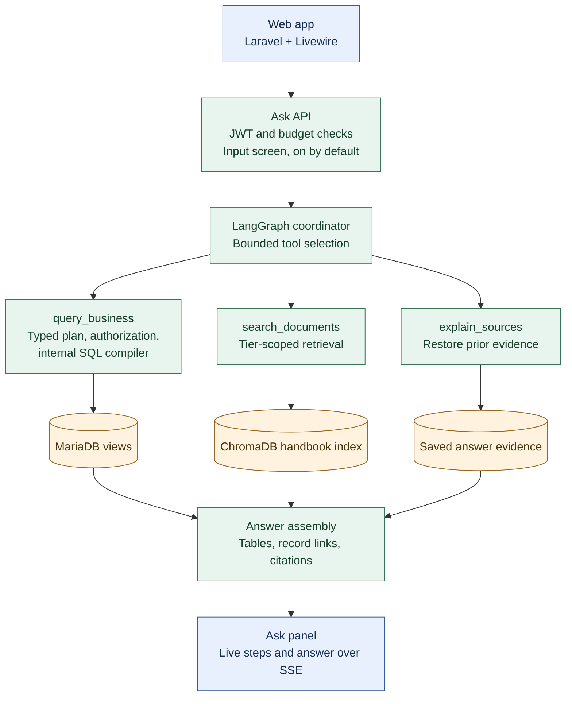

# AI Operations Assistant

**Ask questions about business records and company documents inside the app where your team works.**

It sits inside a company's operations app. Ask it to compare revenue, find unpaid balances, or explain how a handbook policy applies to a number. Answers come with tables, links to the source records, and cited passages. The assistant only sees what the signed-in account may see.

[Watch the 73-second demo](#demo-video) · [Explore the architecture](#architecture) · [Run locally](#run-locally)

Python · FastAPI · LangGraph · Laravel · Livewire · MariaDB · Postgres · Redis · ChromaDB

## Demo video

https://github.com/user-attachments/assets/b9e3c1fb-570a-40bb-9b21-a4a93cabdc60

The walkthrough compares two quarters, follows an answer to a customer record, and combines a handbook definition with a database calculation. The conversation follows you when you change pages.

[Open the video file](docs/media/ai-operations-assistant-demo.mp4) if the player does not load.

## What you can try

After [starting the demo locally](#run-locally), open [localhost:8095](http://localhost:8095). Choose **Try as Finance** or **Try as Warehouse**. No password is needed.

Each expected answer was checked against the demo data before anyone asked the assistant. The queries are in [docs/demo-answers.md](docs/demo-answers.md).

| Question | Account | Expected | What to look for |
|---|---|---|---|
| Compare invoiced revenue in Q1 2026 vs Q4 2025 | Finance | $77,769.14 vs $155,583.40, down 50.0% | A comparison calculated from business records |
| What was our collection rate in July 2025? | Finance | 5.3% | A calculated result from business records |
| Which customers owe us the most right now? | Finance | Upland Society first, then Vinemount Society | A ranked table with links to customer records |
| How many finished jobs have no invoice? | Warehouse | 1,463 | An operational question about job records |
| What was our collection rate in July 2025? | Warehouse | A refusal, with no figures | A permission refusal instead of financial figures |
| How many paid time off days do full-time staff get per year? | either | 18 days, quoting the handbook | An answer grounded in the handbook |
| What does collection rate mean in our handbook, and what was ours in July 2025? | Finance | 5.3%, with the handbook's definition and a citation, in one answer | A definition and a calculated result in one answer, with a document citation |

Finance sees jobs, invoices, and customers. Warehouse sees jobs. Ask both accounts for the collection rate to see the permission check: Warehouse gets a refusal. Both accounts are read-only.

## What makes it work

**Business meaning lives in a semantic layer.** For business queries, the model produces a typed plan using defined measures, dimensions, filters, and periods. Application code authorizes that plan and compiles it to SQL. The model never writes the SQL that runs on this path.

**Permissions cross the application boundary.** The web app signs a 30-second service JWT with the user's permissions and access context. The API verifies it, scopes business queries, and restricts document retrieval by access tier. A request to explain an earlier result also goes through the evidence-restore path.

**One question can need two sources.** A bounded LangGraph coordinator selects business queries, document search, or earlier evidence. It can combine a database result with a handbook passage, ask for clarification, or explain that a question is outside scope.

**The answer stays connected to the workflow.** Server-sent events carry progress and results to the Ask panel. Record links open the underlying entries, and saved evidence brings the thread back after you change pages.

## Measured decisions

We measured each change below on a frozen test suite before keeping or dropping it. [docs/engineering-decisions.md](docs/engineering-decisions.md) has the method, sample sizes, confidence intervals, and results from the earlier design.

| Decision | Result | Caveat |
|---|---|---|
| Split the handbook by markdown headings | Right passage in the top 5 rose from 14 to 46 of 62 questions. Citation precision rose from 0.69 to 0.79. | One run per arm, development corpus |
| Input screen with per-question thresholds, not a keyword rule | 45 of 48 held-out attacks caught, against 25. No normal messages flagged in either (156). | One weak attack class was fixed later with a code rule |
| Keep TypeSafe Jev, not the OpenAI Decisions API, for screening | Blocked 39 of 48 attacks, against 31. p50 latency 91 ms, against 151 ms. About a third of the cost per turn. | The test questions were tuned for Jev |
| Planner reasoning effort "high", not "xhigh" | Same 39 of 57 cases passed. "xhigh" used 64% more reasoning tokens. A two-plan question fell from 22.1 s to 12.6 s. | Latency from 2 runs per arm |
| Move to GPT-6 Luna | Cost per answered question halved, from $0.0044 to $0.0022. Same 23 of 24 answered. | p90 latency rose from 20.0 s to 29.3 s |
| Dropped: send the planner a shortlist of tables | 40% fewer prompt tokens, but no measurable speed gain | Stopped at the first gate |
| Dropped: DeepSeek V4.1 Flash on every model call | Answered 17 of 24, against 23. Cost per answered question rose 43%. | Not adopted |
| Dropped: rerank retrieved passages | Recall@5 fell from 0.935 to 0.903 | Turned off |

## Architecture



This shows the successful question path. Permission denials, input-screen blocks, clarification, and unavailable tools have separate outcomes. Tool and decision limits bound the coordinator loop.

The supplied Compose stack uses the **internal SQL compiler**. The code also includes a Cube adapter, used only when a Cube URL is set; a Cube service is not part of this demo stack. Postgres stores query records and execution evidence, while Redis supports conversation state and other application services.

## Read the implementation

| Concern | Code |
|---|---|
| Tool selection and bounded execution | [Coordinator graph](app/conversation/coordinator/graph.py), [policy](app/conversation/coordinator/policy.py) |
| Typed plans, authorization, and SQL compilation | [Business query module](app/business_query/wire/module.py), [compiler](app/business_query/compile/adapter.py) |
| Signed access context | [Web app JWT client](billing/app/Services/RagClient.php), [API verification](app/auth/jwt.py) |
| Document retrieval and access tiers | [Document executor](app/rag/retrieval/document_execution.py) |
| Input screening | [Screen](app/guardrails/input_screen/screen.py), [decision policy](app/guardrails/input_screen/decision.py) |
| Evaluation tooling | [Coordinator scoring](app/eval/conversation_coordinator.py), [business query evaluation](app/eval/business_query/), [document evaluation](app/eval/document_rag/) |
| Application tests | [Demo access tests](billing/tests/Feature/Demo/), [authorization test](billing/tests/Feature/Ai/AiSearchV2AuthorizationTest.php), [evidence restoration tests](billing/tests/Feature/Ai/RestoreEvidenceTest.php) |

The evaluation suites run in the private development repo. Their cases include real staff questions, so they are not published, and `tests/eval_dataset.json` is empty here. [Measured decisions](#measured-decisions) and [docs/engineering-decisions.md](docs/engineering-decisions.md) summarise the results. The image workflow builds and publishes the containers. It does not run the evaluations.

## Repository layout

| Path | Purpose |
|---|---|
| `app/`, `alembic/`, `config/` | Ask API, migrations, and configuration |
| `billing/` | Laravel and Livewire web app, including the Ask panel |
| `data/corpus/` | Company handbook used for document retrieval |
| `compose.demo.yml` | Application, Ask API, MariaDB, Postgres, and Redis services |
| `compose.local.yml` | Local image builds and HTTP access on port 8095 |
| `.github/workflows/images.yml` | Container build and GHCR publishing workflow |

## Run locally

You need Docker with a current Docker Compose v2 release that supports [`!override`](https://docs.docker.com/reference/compose-file/merge/#replace-value), an OpenAI API key, and the `mcp_demo_v4.sql.gz` database asset from [Releases](https://github.com/abhaloo/mcp-assistant-demo/releases). Download the asset into the repository root. The commands below use bash on Linux, macOS, WSL, or Git Bash on Windows, from the repository root.

### 1. Copy configuration and build the images

```bash
cp billing.env.example billing.env
cp rag.env.example rag.env
dc="docker compose -f compose.demo.yml -f compose.local.yml"
$dc build
```

### 2. Generate keys and configure the services

Generate a Laravel application key with the built web image:

```bash
$dc run --rm --no-deps --entrypoint php app -r 'echo "base64:".base64_encode(random_bytes(32)).PHP_EOL;'
```

Put the printed value in `APP_KEY` in `billing.env`.

Generate a shared JWT secret, a separate redaction secret, and the event-encryption keyring with the built API image:

```bash
$dc run --rm --no-deps --entrypoint python rag-api -c "import base64,json,secrets; print('RAG_JWT_SECRET='+secrets.token_hex(32)); print('REDACTION_HMAC_KEY='+secrets.token_hex(32)); print('BUSINESS_QUERY_EVENT_ENCRYPTION_KEYS='+json.dumps({'current':'v1','keys':{'v1':base64.b64encode(secrets.token_bytes(32)).decode()}},separators=(',',':')))"
```

Copy the generated values into the env files:

- Put the same `RAG_JWT_SECRET` in **both** files.
- Put `REDACTION_HMAC_KEY` and `BUSINESS_QUERY_EVENT_ENCRYPTION_KEYS` in `rag.env`. Keep the keyring JSON on one line.
- Put your OpenAI key in both `OPENAI_API_KEY` and `MODEL_API_KEY` in `rag.env`.
- Set `TYPESAFE_API_KEY` for input screening, or set `ASK_INPUT_SCREEN_MODE=off` to run without that optional service. Screening will be disabled in that mode.

Keep the remaining example settings for a fresh local deployment, including the tool-profile hash and fresh-ledger readiness values. The API requires the encryption keyring when event payload encryption is enabled. Keep these generated keys private and retain them across restarts.

### 3. Start MariaDB and Redis, then import the data

```bash
$dc up -d mariadb redis
$dc ps
```

Wait until MariaDB is healthy. Then import the dump as root, because its views use root as their definer:

```bash
gzip -dc mcp_demo_v4.sql.gz | $dc exec -T mariadb mariadb -u root -pchange-me-root mcp_demo
```

This command uses the supplied local database name and root password. If you change the Compose database settings, update the import command to match.

### 4. Prepare the web app and demo accounts

```bash
$dc up -d --no-deps app
$dc exec -T app php artisan migrate --force
$dc exec -T app php artisan ai-projections:apply mysql
$dc exec -T app php artisan ai-business-query:apply mysql
$dc exec -T app php artisan demo:lock-personas
```

The last command locks down the two demo accounts and replaces their passwords. Use the persona buttons to enter the app.

### 5. Start the remaining services and index the handbook

```bash
$dc up -d
$dc ps
```

Wait until `rag-api` is healthy, then run:

```bash
$dc exec -T rag-api python scripts/deploy/ingest.py
$dc restart rag-api
```

Indexing replaces the handbook collection. Restarting the API loads the new collection.

### 6. Open the app

Visit [http://localhost:8095](http://localhost:8095) and choose a persona. If startup fails, inspect `$dc logs rag-api` and `$dc logs app`. Check the application key, encryption keyring, matching JWT secrets, and input-screen configuration first.

## Scope and operating limits

This demo is adapted from a production application. The demo company is a fictional print shop, and the data is **anonymised**, with invented names. It covers jobs, invoices, customers, and a staff handbook. To use it with another system, you map that system's records, business definitions, permissions, and documents.

The demo accounts cannot change business records. TypeSafe Jev screens each question and can block a flagged one before the coordinator runs. Like any model, it can miss an attack, and permission checks stay in force either way. The supplied model configuration uses external services, so do not enter confidential information into the demo.

The web app has a configurable soft monthly usage allowance (`RAG_AI_MONTHLY_CAP=5` in the example), and the API has a ledger-backed account-budget admission check. These controls are not a guarantee about a provider's final bill. Configure and verify provider-side limits separately.

## Feedback and maintenance

This repository is generated from maintained source trees. Please [open an issue](https://github.com/abhaloo/mcp-assistant-demo/issues) for feedback or integration questions; direct pull requests can be overwritten during publication. Use the [security policy](SECURITY.md) for vulnerability reports.

## License

MIT. See [LICENSE](LICENSE).
