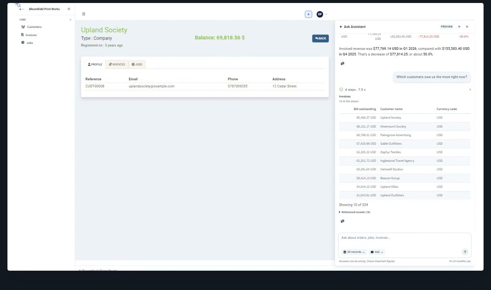
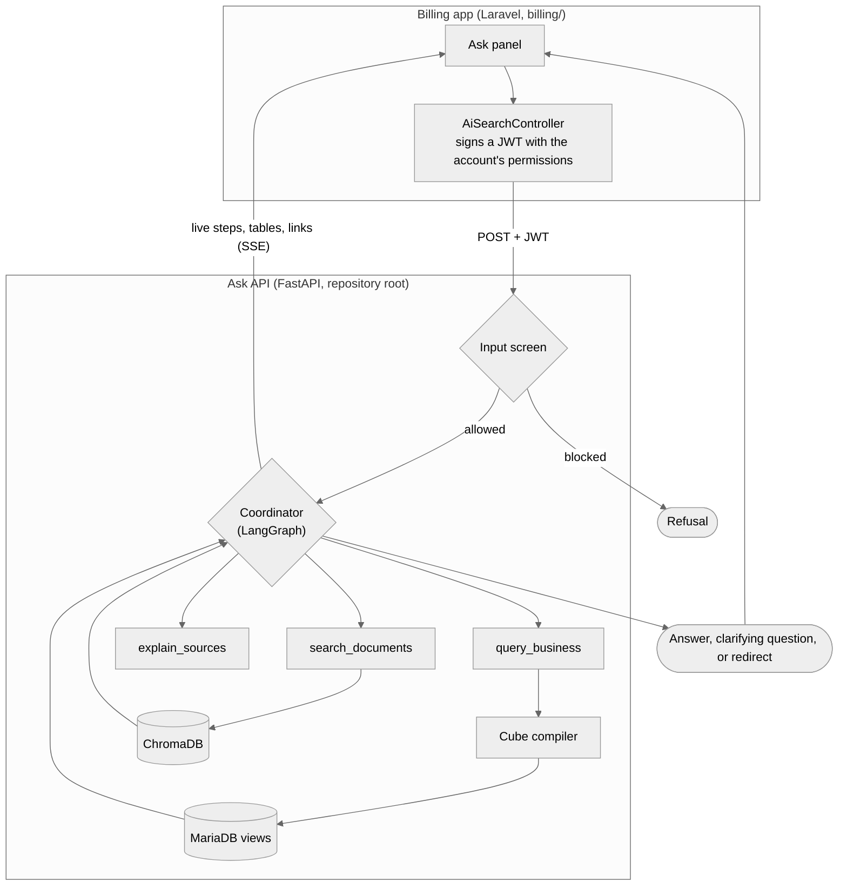

# MCP Assistant Demo

This is an assistant in the side panel of a billing app. You ask it a question in plain English and it answers from the company's billing database or from its staff handbook. Database answers come back as tables, and each row links to the invoice, job or customer it came from. Handbook answers quote the passage they used.

The model never writes SQL. It picks a semantic query (a measure, some filters, a date range), and a Cube compiler turns that into SQL over read-only MariaDB views. What it can query depends on who is asking: the warehouse account has no invoice permission, so when it asks about invoices the assistant says it can't answer rather than guessing. Every question also goes through a third-party screening model first, and a question that tries to override the assistant's instructions is refused before the main model sees it.

The demo is a cut-down copy of a billing app that a print shop uses in production. Bloomfield Print Works is made up, and so is every name in the data. The amounts are scaled and the dates are shifted, so none of the figures match the real business.

## Try it

The landing page has two buttons. You don't need a password.

| Button | Account | Can open | Good first question |
|---|---|---|---|
| Try as Finance | `demo_finance` | Jobs, Invoices, Customers | Compare invoiced revenue in Q1 2026 vs Q4 2025 |
| Try as Warehouse | `demo_production` | Jobs | How many finished jobs have no invoice? |

Both accounts are read-only. The server refuses saves, deletes, approvals, uploads and password changes, whether or not a button for them is on screen.

## Demo video

<!-- VIDEO: after uploading docs/media/bloomfield-ask-demo.mp4 as a GitHub attachment, put the user-attachments URL alone on the next line so GitHub plays it inline. -->

[](docs/media/bloomfield-ask-demo.mp4)

In under a minute, the Finance account compares two quarters of invoiced revenue and asks who owes the most. It opens one of the linked customers, and the earlier answers come back on the new page. Then it asks a handbook question in the same thread.

## What it answers

These numbers come from the demo database. They were checked with plain SQL against the loaded dump before anyone asked the assistant.

| Question | Account | Expected |
|---|---|---|
| Compare invoiced revenue in Q1 2026 vs Q4 2025 | Finance | $77,769.14 vs $155,583.40, down 50.0% |
| What was our collection rate in July 2025? | Finance | 5.3% |
| Which customers owe us the most right now? | Finance | Upland Society first, then Vinemount Society |
| How many finished jobs have no invoice? | Warehouse | 1,463 |
| What was our collection rate in July 2025? | Warehouse | A refusal, with no figures |
| How many paid time off days do full-time staff get per year? | either | 18 days, quoting the handbook |

If you ask about something outside billing and the handbook, the assistant tells you what it can help with.

## How a question is answered



1. The panel posts the question to the billing app. The billing app signs a JWT that lists what the account may see, and sends the question to the Ask API.
2. The input screen runs first. A blocked question gets a refusal, and the model never sees it.
3. The coordinator picks a tool:
   - `query_business` builds a semantic query, and the Cube compiler runs it against the read-only views;
   - `search_documents` searches the handbook in ChromaDB;
   - `explain_sources` re-opens evidence from an earlier answer.
4. It repeats until it can answer, ask you a clarifying question, or point you to what it can help with.
5. While it works, the panel shows each step as it happens. Table rows link to the invoice, job or customer page they came from.

## Repository layout

| Path | What it is |
|---|---|
| `app/`, `alembic/`, `config/` | The Ask API (Python, FastAPI, LangGraph) |
| `billing/` | The trimmed billing app (Laravel 13, Livewire): login, Jobs, Invoices, Customers, and the Ask panel |
| `data/corpus/` | The handbook the assistant searches |
| `compose.demo.yml` | The full stack: billing, Ask API, MariaDB, Postgres, Redis |
| `compose.local.yml` | Local override: builds both images and serves the app on port 8095 |
| `.github/workflows/images.yml` | Builds both images and pushes them to GHCR |

## Run it locally

You need Docker, an OpenAI API key, and the demo database dump `mcp_demo_v4.sql.gz` from this repository's Releases page.

The commands below are for a bash shell (Linux, macOS, WSL or Git Bash on Windows).

1. Copy the env examples and fill in the keys:

   ```bash
   cp billing.env.example billing.env
   cp rag.env.example rag.env
   ```

   In `rag.env`, put your OpenAI key in both `OPENAI_API_KEY` and `MODEL_API_KEY`. Set `TYPESAFE_API_KEY` for the input screen, or set `ASK_INPUT_SCREEN_MODE=off` to run without it. The API won't start if the screen is on but has no key. Put the same long random string in `RAG_JWT_SECRET` in both files.

2. Build the images and start the database:

   ```bash
   dc="docker compose -f compose.demo.yml -f compose.local.yml"
   $dc build
   $dc up -d mariadb redis
   ```

3. Load the data. Run this as root, because the dump's views name root as their definer:

   ```bash
   gzip -dc mcp_demo_v4.sql.gz | $dc exec -T mariadb mariadb -u root -pchange-me-root mcp_demo
   ```

4. Start the billing app on its own. Then add the views the assistant reads, and lock the two demo accounts:

   ```bash
   $dc up -d --no-deps app
   $dc exec -T app php artisan migrate --force
   $dc exec -T app php artisan ai-projections:apply mysql
   $dc exec -T app php artisan ai-business-query:apply mysql
   $dc exec -T app php artisan demo:lock-personas
   ```

   `demo:lock-personas` leaves both accounts read-only and gives each a random password that nobody knows. That's why the landing page has buttons instead of a login form.

5. Start the rest, then index the handbook once the Ask API is healthy:

   ```bash
   $dc up -d
   $dc exec -T rag-api python scripts/deploy/ingest.py
   ```

6. Open [http://localhost:8095](http://localhost:8095) and choose a button.

## Spend limits

Each account's questions are counted, and the count stops at $5 a month (`RAG_AI_MONTHLY_CAP=5`). After that, the panel says the limit is reached. The model key has its own $5 monthly limit at the provider, so the bill stays capped even if the app's counter fails.

## Contributing

A script generates this repository from private source trees. Pull requests here will be overwritten, so please open an issue instead.

## License

MIT. See [LICENSE](LICENSE).
